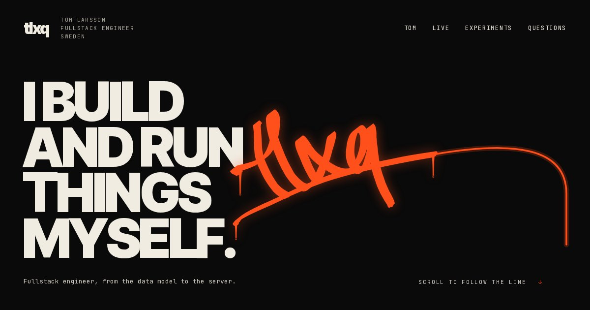

<p align="center"></p>

My portfolio, at [ttdevs.com](https://ttdevs.com). The word `tlxq` is the whole site: t is Tom, l is Live,
x is Experiments, q is Questions. One line runs down the page and writes it as you scroll.

Checks run on my own PC before every merge: `mise run check`, and `mise run walk` walks the built page in a
headless browser at laptop, tablet and phone sizes.

## Run it

```sh
mise install
mise run open
```

`mise run open` builds the static site into `out/` and opens it. `mise run dev` is for live editing.

## How it's built

- Next.js with a static export, and React. No UI kit: the line and the handwriting are drawn by the site itself.
- Every colour, size, space and speed comes from `src/design/tokens.css`.
- The words are in `src/content/look.ts`. The handwritten ones are strokes I wrote with a pen on my phone
  (`mise run write`), saved in `src/content/hand`.
- `docs/design.md` has the rules for how it looks and moves.

## Licence

MIT, see `LICENSE`. The pictures and fonts have their own terms, listed in `CREDITS.txt`.
